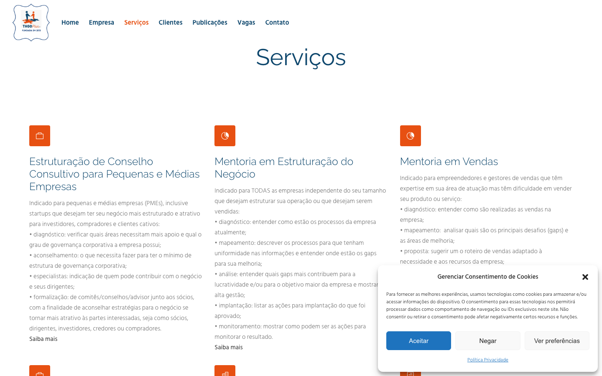

# Auditoria do site: THGO Plus

**URL:** https://www.thgoplus.com.br/ (o domínio sem www redireciona por HTTP 301).  
**Data:** 2026-11-10, America/Sao_Paulo — reexecução após instalação do Playwright.

Nova coleta independente das nove páginas, novo lançamento do Chromium e novas consultas PageSpeed mobile/desktop. O relatório anterior foi preservado.  
**Estado:** baseline documental e visual disponível; interações, contraste e performance ainda parciais.  
**Escopo:** home, Empresa, Serviços, Clientes, Testemunhos, Contato, Blog, Política de Privacidade e Termos de Uso. As nove URLs responderam HTTP 200. Também foram consultados robots.txt e sitemap.xml, sem acesso administrativo.  
**Ferramentas:** curl, parser HTML em Python e Playwright instalado; nova tentativa com Chromium via Playwright 1.65.0. Nenhum formulário foi enviado, contato iniciado ou conteúdo do site alterado.

**Execução visual:** o usuário executou `inspect.cjs` no Terminal fora do ambiente restrito, gerando evidências entre 14:29:02 e 14:29:08 UTC (11:29 em São Paulo). Foram conferidos seis registros de DOM e 12 imagens: viewport e página completa de Home, Serviços e Contato, em **1440 × 900** e **390 × 844**, Chromium/Playwright. As outras seis páginas têm inspeção HTTP/HTML, sem captura visual nesta rodada.

**Limitações:** o bloqueio do Chromium permanece no ambiente restrito do agente, mas não impediu a coleta externa acima. O roteiro não interagiu com menus, consentimento ou links, não percorreu a página para ativar elementos sob demanda e não testou teclado, foco, zoom, reflow a 320 px ou movimento reduzido. Não coletou cores computadas para contraste. Registrou `pageerror` e `requestfailed`, mas não mensagens de console nem respostas HTTP de erro em recursos. PageSpeed retornou HTTP 429 nos dois dispositivos; métricas e existência de dados CrUX permanecem indisponíveis. Não há conclusão de conformidade WCAG, ranking, receita ou conversão. RTK.md não foi localizado nos caminhos consultados.

## Resumo executivo

O conteúdo apresenta claramente a atuação em consultoria, mentoria, vendas e governança para empresas. A página Empresa documenta a trajetória da fundadora; Testemunhos oferece relatos atribuídos a pessoas e organizações; os serviços possuem descrições que ajudam a entender o escopo da contratação. O acesso HTTP às páginas da amostra funcionou.

A base técnica contém problemas concretos: todas as páginas testadas declaram `user-scalable=no`, não têm meta description nem landmark principal no HTML entregue, e referenciam favicons em localhost. A home não possui H1. O contato oferece telefone e e-mail em texto, mas sem os respectivos links diretos. A prioridade é remover a restrição de zoom e melhorar estrutura semântica e contato; a nova coleta permite avaliar a apresentação inicial, mas performance e comportamento interativo continuam pendentes. O layout se adapta às duas larguras sem overflow horizontal na amostra. O aviso de cookies, porém, ocupa aproximadamente 395 dos 844 px de altura no mobile e encobre grande parte do primeiro conteúdo.

Não foram classificados achados High: não há evidência suficiente de tarefa importante bloqueada na página renderizada. Medium indica fricção ou exclusão relevante; Low indica problema pontual ou polimento.

## Tecnologias identificadas

| Categoria | Tecnologia | Evidência e URL | Confiança e limitações |
|---|---|---|---|
| CMS | WordPress | Header `x-redirect-by: WordPress` no domínio sem www; links `api.w.org`, `/wp-json/` e recursos `/wp-includes/` no HTML da home | Confirmado por sinais independentes; versão do núcleo não determinada |
| Tema | Bridge | Recursos da home em `https://www.thgoplus.com.br/wp-content/themes/bridge/style.css` e `/themes/bridge/css/stylesheet.min.css` | Confirmado como tema/recurso entregue, versão não determinada |
| Construtor de páginas | WPBakery Page Builder | Meta generator explícita na home e `/wp-content/plugins/js_composer/assets/css/js_composer.min.css?ver=8.3` | Confirmado; `8.3` é versão declarada no parâmetro do recurso, não uma validação da instalação |
| Biblioteca frontend | jQuery | `https://www.thgoplus.com.br/wp-includes/js/jquery/jquery.min.js?ver=3.7.1` | Referência confirmada; execução e versão interna do arquivo não verificadas |
| Consentimento | Complianz | `/wp-content/plugins/complianz-gdpr/` e marcação `cmplz-cookiebanner` | Confirmado no HTML e no aviso renderizado em desktop/mobile; comportamento e bloqueio de cookies não testados |
| Formulário | Ninja Forms | Contêiner `nf-form-2-cont` e referências a Ninja Forms em Contato | Confirmado pelo contêiner, campos `nf-field-*` e formulário renderizado nas capturas de Contato; envio não testado |
| Contato flutuante | Joinchat | `/wp-content/plugins/creame-whatsapp-me/public/css/joinchat.min.css?ver=5.2.3` e texto WhatsApp | Recurso confirmado; abertura e destino não testados |
| Servidor HTTP | Apache | Header `server: Apache` da home | Header observado; não identifica empresa de hospedagem nem arquitetura interna |
| Framework de aplicação frontend | Não determinado | Não foi reunida evidência suficiente para identificar React, Vue ou outro framework | Não presumir ausência de framework pela ausência de assinatura |

## Performance

URL solicitada ao PageSpeed: `https://www.thgoplus.com.br/`, em 2026-11-10, estratégias mobile e desktop, categorias performance, accessibility, best-practices e seo.

| Dispositivo | Lighthouse (quatro categorias) | LCP | TBT | CLS | Tipo de dado |
|---|---|---|---|---|---|
| Mobile | Não disponível — HTTP 429 | Não medido | Não medido | Não medido | Nenhum resultado de laboratório |
| Desktop | Não disponível — HTTP 429 | Não medido | Não medido | Não medido | Nenhum resultado de laboratório |

**CrUX:** existência de dados de campo não verificada. A falha de cota não demonstra ausência de CrUX. As respostas originais estão em [mobile](evidencias-2026-11-10-reexecucao/psi-mobile.json) e [desktop](evidencias-2026-11-10-reexecucao/psi-desktop.json).

A home referencia 38 scripts externos e 19 folhas de estilo no HTML. É um inventário de tags, não de transferências reais ou recursos únicos, e não demonstra lentidão. Recomenda-se medir bytes, cache, bloqueio de renderização e recursos não utilizados antes de remover plugins ou alterar carregamento. Sem Lighthouse, nenhuma oportunidade foi quantificada.

## Achados prioritários

### Medium — Restrição explícita de zoom em toda a amostra

- **Evidência:** as nove páginas contêm `<meta name="viewport" content="width=device-width,initial-scale=1,user-scalable=no">`. Ver [resumo técnico](evidencias-2026-11-10-reexecucao/summary.json).
- **Impacto:** pede ao navegador que restrinja ampliação, podendo prejudicar pessoas com baixa visão nos navegadores que respeitam a diretiva. O comportamento efetivo de ampliação não foi testado; as capturas em largura fixa não validam zoom.
- **Recomendação:** remover `user-scalable=no`; validar zoom de 200% e reflow equivalente a 320 CSS px, incluindo menu, consentimento e contato.
- **Prioridade:** Medium por potencial exclusão em uma função básica de leitura.

### Medium — Estrutura principal de leitura incompleta

- **Evidência:** nenhum `<main>` ou `role="main"` nas nove respostas HTML. A home não tem H1; em Serviços há H1 seguido de H3 e dois H3 vazios. Arquivos [home](evidencias-2026-11-10-reexecucao/home.html) e [serviços](evidencias-2026-11-10-reexecucao/servicos.html).
- **Impacto:** estrutura menos útil para navegação por landmarks e títulos em tecnologias assistivas. Os seis DOMs renderizados também registram zero landmarks principais; a home continua sem H1. A árvore de acessibilidade completa não foi coletada.
- **Recomendação:** criar um landmark principal; dar à home H1 que expresse sua proposta; organizar serviços em H2 e subtópicos em H3; remover títulos vazios. Rever o H5 de contato no rodapé e o H3 “Publicações” que antecede o conteúdo no código.
- **Prioridade:** Medium por afetar orientação e navegação da amostra.

### Medium — Telefone e e-mail exigem ação manual

- **Evidência:** o HTML de [Contato](evidencias-2026-11-10-reexecucao/contato.html) fornece telefone `55 11 4116-0221` e `contato@thgoplus.com.br`, mas não contém links `tel:` ou `mailto:`. O mesmo ocorre no rodapé da home.
- **Impacto:** o visitante pode precisar copiar ou digitar os contatos. Os DOMs renderizados de Contato também não incluem links `tel:` ou `mailto:`. A detecção automática do navegador e o componente de WhatsApp não foram exercitados.
- **Recomendação:** criar links explícitos com nomes claros, por exemplo `tel:+551141160221` e `mailto:contato@thgoplus.com.br`, e validar os destinos do WhatsApp.
- **Prioridade:** Medium por fricção direta na jornada de contratação.

### Medium — Falta de meta description nas nove páginas

- **Evidência:** nenhuma tag `meta name="description"` nos HTML coletados; canonicals existem nas páginas examinadas.
- **Impacto:** perde-se controle editorial sobre a descrição sugerida aos buscadores. Isso não comprova queda de ranking; o buscador pode gerar seu próprio trecho.
- **Recomendação:** escrever descrições específicas para cada página, começando por home, Serviços e Contato, explicando público, oferta e próximo passo.
- **Prioridade:** Medium por abranger páginas centrais de descoberta e decisão.

### Low — Favicons apontam para localhost

- **Evidência:** duas referências por página a `https://localhost/thgo-plus/wp-content/uploads/2019/02/favicon.png`, incluindo na [home](evidencias-2026-11-10-reexecucao/home.html).
- **Impacto:** o endereço aponta para o computador do visitante, não para o site público. É uma configuração de recurso inválida para produção; a falha de carregamento não foi capturada em navegador.
- **Recomendação:** substituir pelos recursos HTTPS no domínio público e verificar os ícones nas diferentes plataformas.
- **Prioridade:** Low, pois o recurso identificado é o favicon, sem evidência de bloqueio de conteúdo ou contratação.

### Low — Revisão editorial e informações de atualização

- **Evidência:** título da home contém “Consleho Consultivo”; texto de livros contém “Alta Perfromance”; rodapé traz `© 2020`. Fonte: [home](evidencias-2026-11-10-reexecucao/home.html).
- **Impacto:** erros pontuais podem enfraquecer percepção de cuidado. A data do copyright não demonstra abandono: o blog também apresenta artigos sobre 2026.
- **Recomendação:** corrigir grafia e revisar títulos, chamadas e datas de manutenção com o responsável pelo conteúdo.
- **Prioridade:** Low por ser polimento editorial localizado.

## Pontos fortes

- Nove páginas essenciais acessíveis por HTTP 200; domínio sem www converge para o domínio canônico.
- `lang="pt-BR"` presente nas nove páginas; canonicals individuais observados na amostra.
- Navegação no HTML aponta para Empresa, Serviços, Clientes, Testemunhos, Publicações, Vagas e Contato.
- Serviços descreve modalidades de atendimento, incluindo conselho consultivo, mentoria e assessoria à LGPD; Empresa contextualiza fundação e trajetória da fundadora.
- Testemunhos contém relatos atribuídos a pessoas e organizações. São declarações publicadas pelo site, sem validação externa nesta auditoria.
- Contato publica horário, telefone, e-mail e endereço de contato sobre privacidade. Termos e Política de Privacidade estão acessíveis; sua adequação jurídica não foi avaliada.
- robots.txt declara sitemaps, permite rastreamento público e restringe `/wp-admin/`; sitemap.xml respondeu HTTP 200. Não foi realizada validação completa das URLs do sitemap.
- Todas as imagens da amostra têm atributo `alt`; há valores vazios (20 de 29 imagens em Empresa e 10 de 16 no Blog). Isso exige revisão contextual: imagem decorativa pode ter alt vazio corretamente; imagem informativa deve ter alternativa útil. Não há conclusão de qualidade das alternativas sem inspeção visual.

## Evidências visuais

Capturas do estado inicial com aviso de cookies aberto; o roteiro não o fechou. Capturas de página inteira não equivalem a percorrer a página: conteúdos animados e sob demanda podem não ter sido ativados.

### Medium — Aviso de cookies ocupa quase metade da primeira tela mobile

- **Evidência:** Home mobile, 390 × 844: painel de aproximadamente y=449 até y=844, cerca de 47% da altura. Também aparece nas capturas de Serviços e Contato. Há controles visíveis Aceitar, Negar, Ver preferências e fechar.
- **Impacto:** reduz a área disponível para compreender a oferta e iniciar a jornada enquanto permanece aberto. Não foi demonstrado bloqueio permanente: os controles não foram acionados.
- **Recomendação:** reduzir a altura e revisar a apresentação mobile preservando escolhas claras; testar fechamento e acesso por teclado.
- **Prioridade:** Medium por fricção relevante na chegada mobile.

### Low — Conteúdo de serviços extenso no mobile

- **Evidência:** [Serviços mobile, página completa](evidencias-2026-11-10-reexecucao/servicos-mobile-full.png) empilha descrições detalhadas em uma única coluna; a chamada geral Fale Conosco fica ao final. Os seis DOMs incluem links para Contato no menu, portanto o contato não está exclusivamente no final.
- **Impacto:** comparar modalidades exige percorrer uma página longa; não há evidência de impossibilidade de contratar.
- **Recomendação:** adicionar resumo das modalidades e atalhos internos, preservando os detalhes disponíveis.

### Resultados favoráveis da coleta renderizada

- Nas seis amostras, `scrollWidth` equivale a `innerWidth`: 1440 no desktop e 390 no mobile. Não foi detectado overflow horizontal nessas condições; isso não valida reflow a 320 px.
- Contato renderizou Nome Completo, E-mail, Telefone, Sua mensagem, concordância e Enviar. Os quatro campos de contato e a concordância têm labels associadas no DOM. O botão de envio sem `label` não é, por si só, um erro: seu nome acessível não foi calculado.
- Os seis registros têm `errors: []` para os eventos coletados (`pageerror` e `requestfailed`); isso não significa ausência de respostas HTTP com erro ou de avisos no console.
- Menu desktop e ícone mobile aparecem nas capturas, e as colunas de conteúdo se reorganizam na largura mobile. A abertura do menu não foi testada.

### Cuidados de interpretação

O contador de satisfação aparece como `0%` nos DOMs e nas capturas completas; áreas de Coautorias e parte do rodapé desktop aparecem vazias. Como o roteiro não rolou a página nem aguardou animações dessas seções, isso pode ser consequência da coleta. Não são classificados como falhas persistentes do site sem novo teste com rolagem. O texto do hero também varia entre as capturas de viewport e página completa, compatível com conteúdo animado; uma captura isolada não comprova ausência definitiva de mensagem.

## Validações pendentes

| Verificação | Estado |
|---|---|
| Desktop e mobile | Concluída coleta visual inicial de Home, Serviços e Contato nas duas larguras; demais páginas apenas HTTP/HTML |
| Menus, submenus, âncoras e consentimento | Não exercitados pelo roteiro |
| Teclado, foco e nomes acessíveis | Não testados; labels dos campos foram coletadas |
| Contraste | Sem pares de cores computadas e sem razões medidas; não há conclusão de aprovação ou reprovação |
| Zoom, 320 px e movimento reduzido | Não testados |
| Formulário | Renderização e labels verificadas; envio e validação de erros não testados |
| Contadores e conteúdo sob demanda | Requerem rolagem e espera antes de concluir falha |
| Performance e CrUX | PageSpeed HTTP 429 em mobile e desktop |

## Inventário de evidências e reprodução

Pasta: [evidencias-2026-11-10-reexecucao](evidencias-2026-11-10-reexecucao/).

- `home`, `a-empresa`, `servicos`, `clientes`, `testemunhos`, `contato`, `blog`, `politica-privacidade`, `termos-de-uso`: pares `.html` (resposta) e `.json` (tags e texto extraídos). Cada JSON registra URL e status HTTP. Headers nesses JSON estão vazios; os cabeçalhos reais da home estão em `home-headers.txt`.
- `summary.json`: matriz de H1, meta description, landmark principal, viewport e referências localhost.
- `robots.txt` e `sitemap.xml`: respostas públicas preservadas.
- `psi-mobile.json`, `psi-desktop.json`: erros originais do PageSpeed, sem métricas.
- `*-desktop.png`, `*-mobile.png` e variantes `-full.png`: 12 capturas válidas; `*-dom.json`: seis registros de DOM, viewports, horário e erros observados.
- `playwright.log`: falha anterior dentro do ambiente restrito, não representa a execução externa bem-sucedida; `inspect.cjs`: roteiro de captura desktop/mobile e extração de DOM de home, Serviços e Contato. Executar `node auditorias/evidencias-2026-11-10-reexecucao/inspect.cjs` em ambiente que permita iniciar Chromium. Esse roteiro é coleta inicial; a inspeção manual de menus, foco, contraste e reflow continua necessária.
- `collect.py`: coletor somente leitura; executar com `python3 auditorias/evidencias-2026-11-10-reexecucao/collect.py`. Uma nova execução sobrescreve os HTML/JSON daquela pasta; para comparação futura usar outra pasta datada.

Este documento permite comparar estrutura, conteúdo e apresentação inicial nas duas larguras. A baseline de comportamento interativo e desempenho permanece incompleta.

